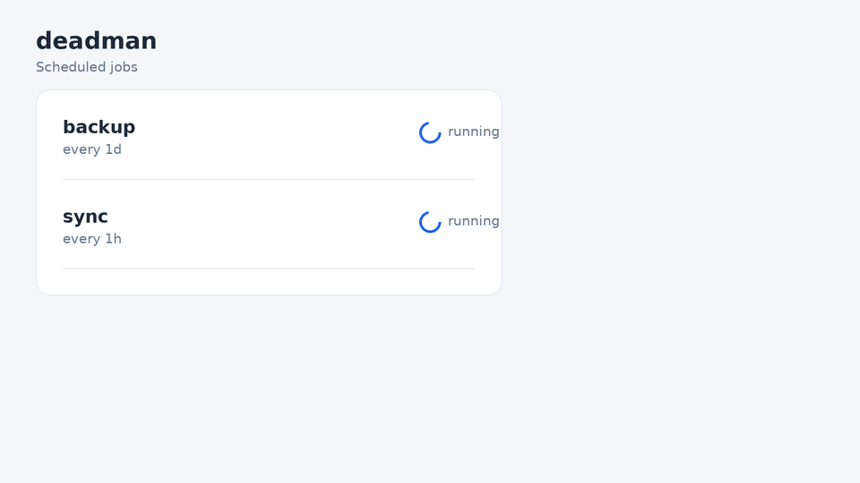

# deadman


**Know the moment a scheduled job fails, or silently stops running.**

```bash
pip install deadman
deadman run backup -- ./backup.sh
```



Cron jobs fail in silence. A backup script breaks on Tuesday, nobody notices, and the first time anyone checks is the day the backup is needed. `deadman` makes that impossible to ignore:

- `deadman run` wraps any command, records whether it succeeded, and shows the last lines of output when it fails.
- `deadman check` reports every job that has failed, or has not succeeded within its expected schedule. Run it from a separate cron entry and a job that goes **silent** is caught too, not just one that fails loudly.
- Alerts are printed, and optionally sent to a webhook: Slack, Discord, or any endpoint that accepts JSON.

Standard library only. No account, no server, no daemon.

## Quick start

1. Wrap your job:

```bash
deadman run backup -- ./backup.sh
```

2. Describe the schedule in `deadman.json`:

```json
{
  "jobs": [
    { "name": "backup", "every": "1d", "grace": "1h" },
    { "name": "sync", "every": "1h", "grace": "10m" }
  ]
}
```

3. Check the jobs regularly:

```bash
deadman check --config deadman.json
deadman status --config deadman.json
```

## Get alerts on Slack or Discord

Set a webhook URL, and every failure or late job is sent there as well as printed:

```bash
export DEADMAN_WEBHOOK="https://hooks.slack.com/services/..."
```

Discord webhooks work the same way. The payload includes both `text` and `content`, so either service reads it.

## Run it from cron

Wrap the real job, and check everything from a separate entry:

```cron
0 2 * * *   deadman run backup -- /home/me/bin/backup.sh
*/15 * * * * deadman check --config /home/me/deadman.json
```

## Durations

`30s`, `5m`, `24h`, `7d`. The `grace` option is extra time tolerated before a job counts as late. It defaults to `10m`.

## Important: where the check runs

`deadman check` only detects silence if it runs somewhere that keeps working when the job's machine stops. A check on the same machine dies with it. For a server, run the check on a second machine, or use an external heartbeat service for the last link.

## Try the demo

```bash
git clone https://github.com/your-handle/deadman
cd deadman
pip install -e ".[dev]"
DEADMAN_HOME=/tmp/deadman-demo deadman run backup -- sh examples/backup.sh
DEADMAN_HOME=/tmp/deadman-demo deadman run sync -- sh examples/broken.sh
DEADMAN_HOME=/tmp/deadman-demo deadman status --config examples/deadman.json
```

## Where state lives

Results are stored in `~/.deadman/state.json`. Set `DEADMAN_HOME` to change the directory. A run never overwrites the last success on failure, so `check` keeps pointing at the last time the job really worked.

## Limits

- It tells you that something failed or went silent. It does not repair anything.
- Jobs are identified by name. Two machines using the same state file will share the same records.
- Output is streamed live, but deadman keeps only the last 12 lines for alerts.

## Development

```bash
pip install -e ".[dev]"
pytest
```

## Roadmap

- [ ] Hosted heartbeat endpoint (no second machine needed)
- [ ] Email alerts
- [ ] `deadman install-cron` to write the crontab lines for you
- [ ] Support for per-job timeouts

## License

MIT

